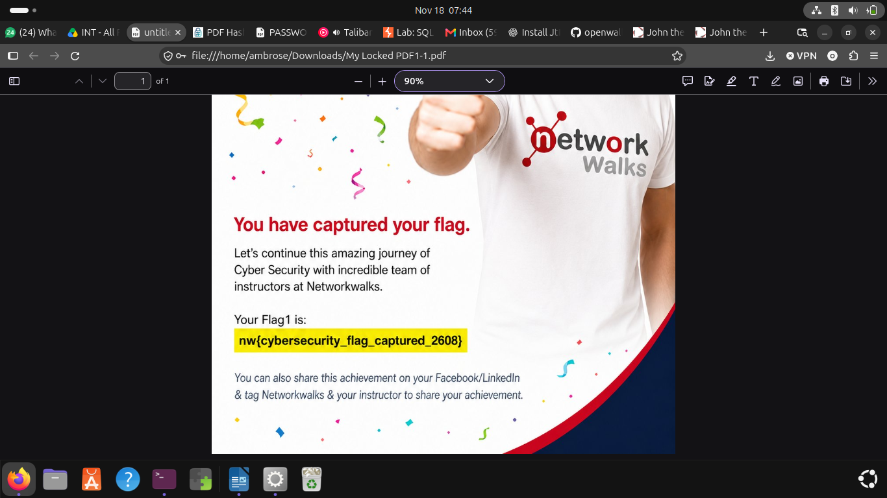
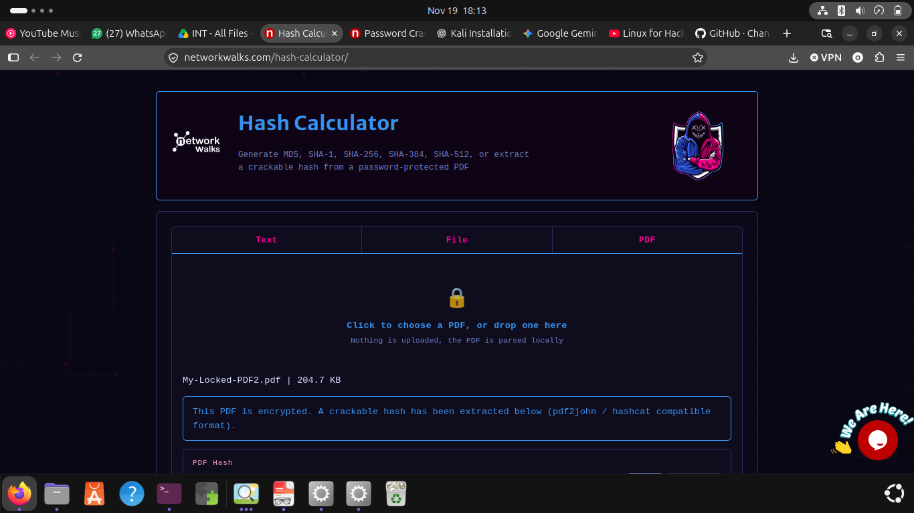

# Networkwalks Week 3: Password Cracking Labs

## Overview

This repository documents my Week 3 cybersecurity practical activities during Networkwalks training.

The practical focused on understanding password security, password hashing and password auditing using John the Ripper and Networkwalks online password-cracking tools.

## Objectives

- Understand password hashing.
- Learn how password hashes are generated.
- Practise password auditing using John the Ripper.
- Explore online password-cracking tools.
- Understand the importance of strong passwords.

## Tools Used

### 1. John the Ripper (JTR)

John the Ripper is an open-source password security auditing and recovery tool used to identify weak passwords through different password-testing techniques.

Activities:
- Installing and exploring John the Ripper.
- Working with password hash files.
- Performing wordlist-based password auditing.
- Examining password recovery results.

### 2. Networkwalks Hash Calculator

The Networkwalks Hash Calculator was used to generate or extract password hashes during the practical exercise.

### 3. Networkwalks Password Cracker

The Networkwalks Password Cracker was used to perform password recovery attempts using the generated hash.

## Practical Workflow

1. Prepared the password-protected PDF test file.
2. Used the Networkwalks Hash Calculator to obtain its password hash.
3. Used the Networkwalks Password Cracker to attempt password recovery.
4. Used John the Ripper to perform password auditing through the Linux terminal.
5. Observed and documented the results.

## Repository Structure

```text
.
├── README.md
├── John-The-Ripper/
│   └── screenshots/
├── Networkwalks-Online-Tools/
│   └── screenshots/
└── reports/
```

## Skills Acquired

- Linux command-line operations.
- Password auditing.
- Password hash identification.
- Wordlist-based password testing.
- Basic understanding of password security.
- Practical use of cybersecurity tools.

PRACTICAL EVIDENCE







## Lessons Learned

The exercise demonstrated the importance of password strength and secure password storage.

It also provided practical experience with command-line security tools and web-based password-auditing utilities.

## Disclaimer

All activities documented in this repository were conducted for educational purposes in an authorised training environment using test files.

No unauthorised systems or accounts were targeted.

## Author

Ambrose Opondo

Cybersecurity | Backend Development | Network Infrastructure
